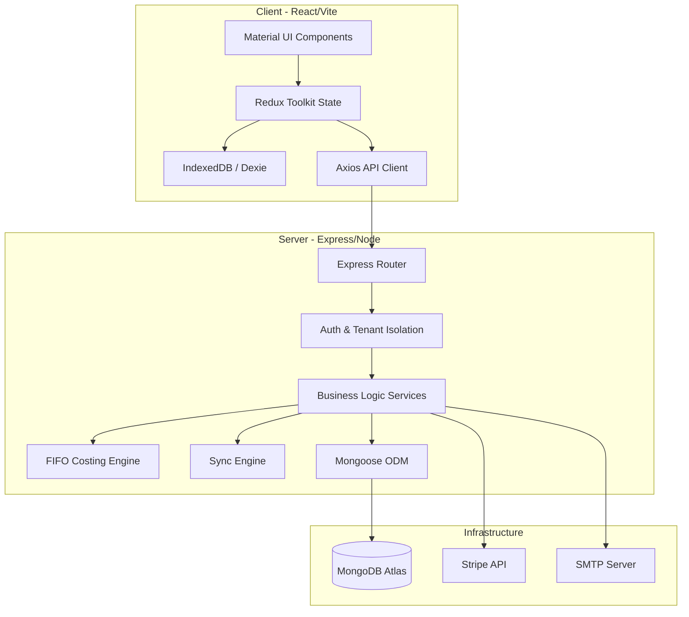
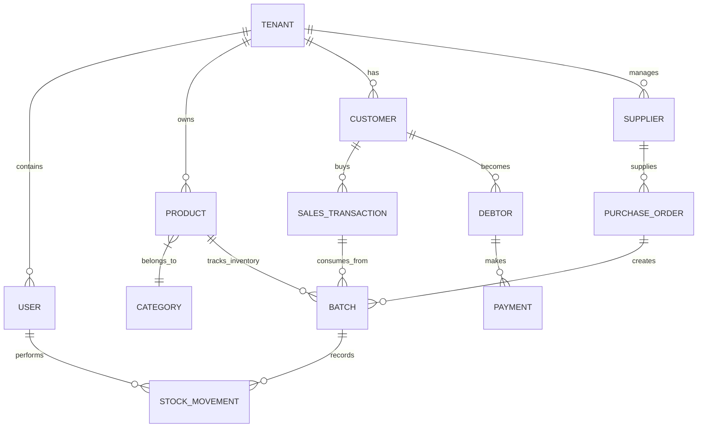
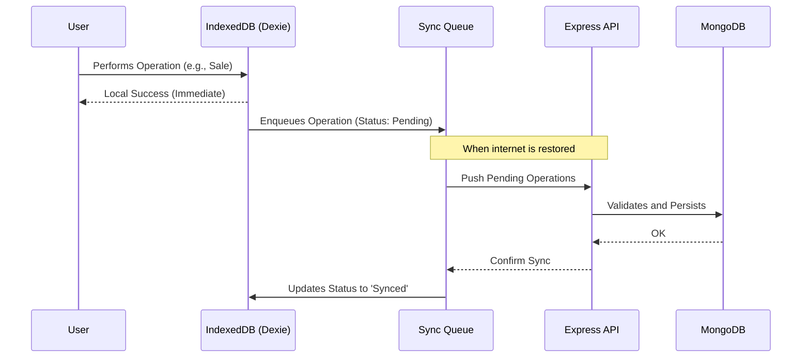

# Visual Architecture: Stocky SaaS

This artifact provides a diagrammatic view of the structure and data flow of Stocky SaaS.

## 1. High-Level Architecture Diagram

---

## 2. Entity-Relationship Diagram (Simplified)

---

## 3. Offline Synchronization Flow

---

## 4. Key Server Components

| Component | Responsibility |
| :--- | :--- |
| `tenantIsolation.js` | Ensures each request is filtered by the authenticated user's `tenantId`. |
| `fifoCosting.js` | Algorithm that decides which batch to withdraw the product from to maximize fiscal accuracy. |
| `stockMovement.js` | Single entry point for any physical product quantity change. |
| `schemas.js` | Single source of truth for all system data. |
